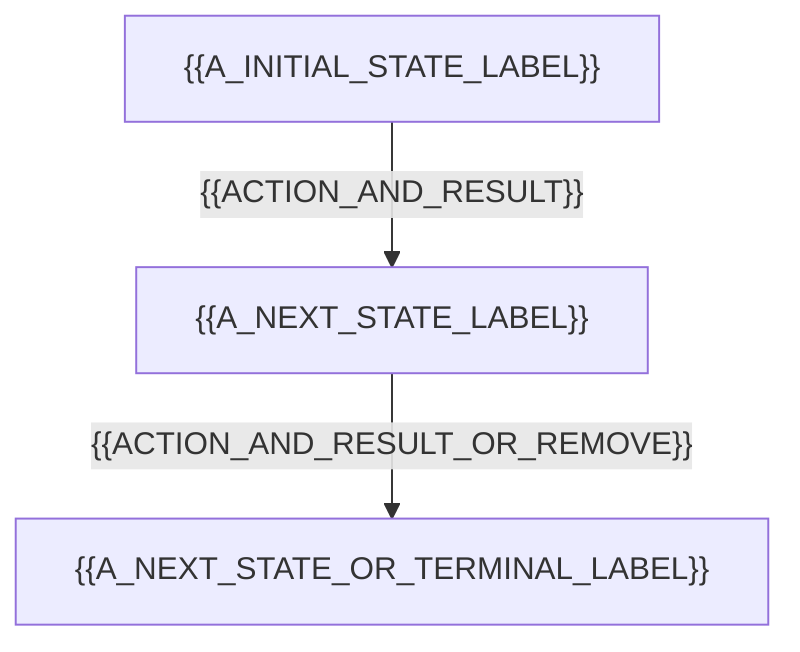
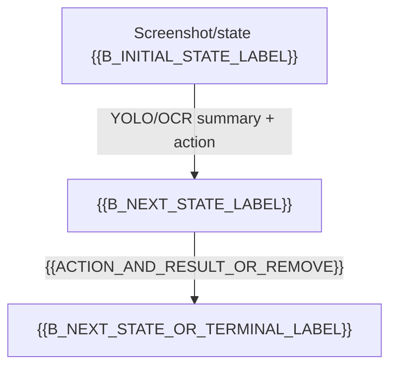
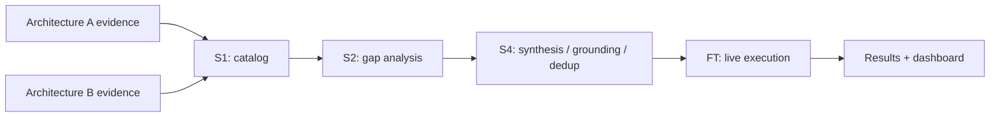

# {{SITE_NAME}} — Site Run Report

> **Purpose:** compact research record for one immutable run. Summarized values must be traceable to source artifacts. Raw YOLO, OCR, screenshot, DOM, and execution detail belongs in linked artifacts, not copied wholesale into this report.
>
> **Template status:** replace every `{{...}}` placeholder from verified run artifacts. Do not leave a placeholder looking like a measured value. Use the explicit availability statuses in §3 when evidence is absent.

## 1. Run at a glance

| Field | Value | Evidence / note |
|---|---|---|
| Site and target | {{SITE_NAME}} — {{TARGET_URL}} | {{TARGET_URL_SOURCE}} |
| Run ID | `{{RUN_ID}}` | {{RUN_MANIFEST_PATH}} |
| Execution window | {{START}} to {{END}} ({{DURATION_OR_STATUS}}) | {{TIMING_SOURCE}} |
| Run outcome | **{{EXECUTION_OUTCOME}}** | {{OUTCOME_BASIS}} |
| Evidence integrity | **{{INTEGRITY_VERDICT}}** | {{INTEGRITY_SUMMARY}} |
| Eligible for campaign aggregate | **{{AGGREGATE_ELIGIBILITY}}** | {{ELIGIBILITY_REASON}} |
| Research question / objective | {{OBJECTIVE}} | {{OBJECTIVE_SOURCE_OR_STATUS}} |
| One-sentence result | {{EVIDENCE_BASED_RESULT}} | {{SUPPORTING_EVIDENCE_IDS}} |

**Read the two verdicts separately:** execution outcome says how the pipeline performed; integrity verdict says whether the collected evidence can be trusted for research aggregation. A technically successful run may still be excluded if its provenance fails.

## 2. Scope and experimental setup

| Attribute | Value | Availability / evidence |
|---|---|---|
| Run mode / pipeline entry point | {{RUN_MODE}} | {{STATUS_AND_SOURCE}} |
| Architecture A implementation/version | {{A_VERSION}} | {{STATUS_AND_SOURCE}} |
| Architecture B implementation/version | {{B_VERSION}} | {{STATUS_AND_SOURCE}} |
| Fusion implementation/version | {{FUSION_VERSION}} | {{STATUS_AND_SOURCE}} |
| Git commit / source revision | {{COMMIT}} | {{STATUS_AND_SOURCE}} |
| Browser / viewport / device profile | {{BROWSER_ENVIRONMENT}} | {{STATUS_AND_SOURCE}} |
| Model provider and model identifier | {{MODEL_PROVIDER_AND_ID}} | {{STATUS_AND_SOURCE}} |
| Prompt/configuration version or hash | {{PROMPT_CONFIG_VERSION}} | {{STATUS_AND_SOURCE}} |
| Run limits / policies | {{TIME_STEP_STATE_DEPTH_LIMITS_AND_POLICIES}} | {{STATUS_AND_SOURCE}} |
| Authentication / seeded state | {{AUTH_STATE_SANITIZED}} | Do not include credentials or secrets |

State whether the run was intended as an ordinary evaluation, a rerun, a recovery attempt, a repeatability sample, or a special probe. Record redirects or material site changes separately from pipeline defects.

## 3. Evidence availability and status vocabulary

Every required metric must have both a value and a status. Use the following status for the metric, rather than replacing absent values with zero or a dash.

| Status | Meaning |
|---|---|
| `RECORDED` | Source evidence exists and the value was extracted. A value of `0` is valid when genuinely observed. |
| `NOT_RECORDED` | The run/artifacts did not record this value. |
| `NOT_APPLICABLE` | The metric does not apply to this run or stage. Give a reason. |
| `STAGE_NOT_RUN` | The stage was never entered. |
| `BLOCKED` | A site, environment, access, quota, or policy barrier prevented the operation. Identify the barrier. |
| `ERROR` | The operation was attempted but failed unexpectedly. |
| `INCONCLUSIVE` | Available evidence cannot establish the value or outcome. |
| `REDACTED` | A value existed but was removed from this research export for privacy/security. |
| `PENDING_VALIDATION` | A candidate value exists but has not passed source/provenance checks. Do not aggregate it. |

Use paired fields for machine-readable entries, e.g. `value: 0; status: RECORDED` or `value: null; status: STAGE_NOT_RUN`. Do not infer `RECORDED` solely from an older report or a dashboard screenshot when the registered run artifact is available for inspection.

## 4. Research summary and principal findings

### Findings supported by this run

| ID | Finding | Type | Evidence references | Confidence / qualification |
|---|---|---|---|---|
| F-01 | {{FINDING}} | `OBSERVATION` / `COMPUTED` / `INTERPRETATION` | {{EVIDENCE_IDS}} | {{QUALIFICATION}} |
| F-02 | {{FINDING_OR_REMOVE_ROW}} | {{TYPE}} | {{EVIDENCE_IDS_OR_STATUS}} | {{QUALIFICATION}} |

### Failures, anomalies and unexpected behavior

| ID | What happened | Scope | Failure classification | Evidence | Impact on conclusion |
|---|---|---|---|---|---|
| X-01 | {{SYMPTOM}} | {{A/B/FUSION/ENVIRONMENT/INTEGRITY}} | {{CLASS_OR_STATUS}} | {{EVIDENCE_IDS}} | {{IMPACT}} |

### Claims this run does **not** support

- {{UNSUPPORTED_OR_UNTESTED_CLAIM_AND_REASON}}

List only conclusions that materially constrain interpretation. Do not present model-generated hypotheses as measured facts.

## 5. Key metrics dashboard

Populate values from registered artifacts. Include numerator and denominator for rates, and the exact formula/version for derived metrics. The table is compact on purpose; detailed step and detection records remain in the artifact manifest.

| Stage / metric | Value | Status | Definition / denominator | Source reference |
|---|---:|---|---|---|
| Architecture A — stage outcome | {{VALUE}} | {{STATUS}} | {{DEFINITION}} | {{SOURCE}} |
| A — actions/steps | {{VALUE}} | {{STATUS}} | Recorded steps; definition must match extractor | {{SOURCE}} |
| A — states/pages visited | {{VALUE}} | {{STATUS}} | Distinguish unique URLs from states | {{SOURCE}} |
| A — termination reason / cap | {{VALUE}} | {{STATUS}} | Preserve actual termination label | {{SOURCE}} |
| A — errors / warnings | {{VALUE}} | {{STATUS}} | Counts plus classifications when available | {{SOURCE}} |
| A — duration | {{VALUE}} | {{STATUS}} | State units; identify timing boundaries | {{SOURCE}} |
| Architecture B — exploration outcome | {{VALUE}} | {{STATUS}} | Exploration and replay are separate outcomes | {{SOURCE}} |
| B — steps/states/URLs | {{VALUE}} | {{STATUS}} | Do not treat these quantities as interchangeable | {{SOURCE}} |
| B — YOLO detections / classes | {{VALUE}} | {{STATUS}} | Aggregate only if raw result schema supports it | {{SOURCE}} |
| B — OCR regions / confidence summary | {{VALUE}} | {{STATUS}} | State OCR confidence scale and aggregation method | {{SOURCE}} |
| B — replay tests | {{PASS}} / {{TOTAL}} | {{STATUS}} | Include skipped/error outcomes separately | {{SOURCE}} |
| S1 catalog — elements / behaviors / pages / conflicts | {{VALUE}} | {{STATUS}} | Report only fields confirmed in registered dashboard/artifacts | {{SOURCE}} |
| S2 gap analysis | {{VALUE}} | {{STATUS}} | Use the actual available gap counters/categories | {{SOURCE}} |
| S4 synthesis — offered / accepted / rejected | {{VALUE}} | {{STATUS}} | Rejections must retain reason counts where available | {{SOURCE}} |
| FT live execution — tests PASS / FAIL / ERROR | {{VALUE}} | {{STATUS}} | Distinguish generated, accepted and executed tests | {{SOURCE}} |
| FT live execution — steps passed / attempted | {{VALUE}} | {{STATUS}} | Do not substitute step pass rate for test pass rate | {{SOURCE}} |
| Verification quality — STRONG / MEDIUM / WEAK | {{VALUE}} | {{STATUS}} | Cite the active rubric/version and denominator | {{SOURCE}} |
| Fusion-attributable percentage | {{VALUE}} | {{STATUS}} | Formula and eligible denominator: {{FORMULA_VERSION}} | {{SOURCE}} |
| Novel targets / targets preverified | {{VALUE}} | {{STATUS}} | Use only if the metric is defined and recorded | {{SOURCE}} |
| LLM calls / tokens / cost | {{VALUE}} | {{STATUS}} | Do not infer from elapsed time or model name | {{SOURCE}} |

**Rate interpretation:** never report a percentage without numerator, denominator, eligibility rules, and any caveat that changes its meaning. A high fusion percentage does not by itself imply high test pass rate or broad site coverage.

## 6. Architecture A — DOM exploration

**Stage outcome:** {{A_OUTCOME}} · **Termination:** {{A_TERMINATION}} · **Integrity:** {{A_EVIDENCE_STATUS}}

Summarize the path and meaningful transitions. Retain each action, but compress repetitive internal observations into per-state counts and linked artifact ranges.

### A path diagram

Replace the example nodes/edges with actual observed states and transitions. If the graph is too large, show major states here and link the full generated graph as an artifact. Do not add pages or transitions that were not observed.

### A transition ledger

| Step | From state/page | Action and target | To state/page | Outcome | Verification / reason | Evidence |
|---:|---|---|---|---|---|---|
| {{STEP}} | {{STATE_A}} | {{ACTION_TARGET}} | {{STATE_B_OR_STATUS}} | {{PASS/FAIL/ERROR/INCONCLUSIVE}} | {{RESULT}} | {{ARTIFACT_POINTER}} |

### A coverage summary

- **Observed strengths:** {{EVIDENCE_BACKED_SUMMARY}}
- **Unexplored or capped scope:** {{LIMITATIONS}}
- **Important errors/warnings:** {{SUMMARY_AND_EVIDENCE}}

## 7. Architecture B — vision exploration and replay

**Exploration outcome:** {{B_EXPLORATION_OUTCOME}} · **Replay outcome:** {{B_REPLAY_OUTCOME}} · **Evidence status:** {{B_EVIDENCE_STATUS}}

### B vision path

### Per-state vision summary

| State / screenshot | YOLO summary | OCR summary | Key observations | Action / resulting state | Outcome | Evidence |
|---|---|---|---|---|---|---|
| {{STATE_ID}} | {{COUNTS_CLASSES_CONFIDENCE_OR_STATUS}} | {{COUNTS_TEXT_CONFIDENCE_OR_STATUS}} | {{COMPACT_SEMANTIC_SUMMARY}} | {{ACTION_AND_NEXT_STATE}} | {{OUTCOME}} | {{SCREENSHOT_AND_JSON_POINTERS}} |

Do not list all detected objects or OCR strings here. Include counts, confidence distributions or notable outliers only if supported by the artifacts and a documented calculation. Preserve unusually relevant detections in a short exception table and link to the complete source JSON.

### B replay results

| Test ID | Intended workflow | Result | Verification strength | Failed/skipped step or reason | Evidence |
|---|---|---|---|---|---|
| {{TEST_ID}} | {{WORKFLOW_SUMMARY}} | {{PASS/FAIL/ERROR/INCONCLUSIVE}} | {{STRONG/MEDIUM/WEAK/STATUS}} | {{REASON}} | {{SOURCE}} |

## 8. Fusion — from catalog to executed tests

Show the available stages in order. If a stage did not run, mark it as such rather than inventing an empty result.

| Stage | Outcome | Input/output summary | Counts / rejection reasons | Evidence |
|---|---|---|---|---|
| S1 — catalog | {{OUTCOME}} | {{SUMMARY}} | {{COUNTS_OR_STATUS}} | {{SOURCE}} |
| S2 — gap analysis | {{OUTCOME}} | {{SUMMARY}} | {{COUNTS_OR_STATUS}} | {{SOURCE}} |
| S4 — synthesis and validation | {{OUTCOME}} | {{SUMMARY}} | {{OFFERED_ACCEPTED_REJECTED_REASON_COUNTS}} | {{SOURCE}} |
| FT — live execution | {{OUTCOME}} | {{SUMMARY}} | {{PASS_FAIL_ERROR_SKIPPED_AND_STEP_COUNTS}} | {{SOURCE}} |
| Dashboard / aggregation | {{OUTCOME}} | {{SUMMARY}} | {{METRICS_AND_FORMULA_VERSION}} | {{SOURCE}} |

### Fusion-generated test ledger

| Test ID | Origin | Target/state coverage | Preconditions / actions summary | Result | Verification strength | Novel target? | Evidence |
|---|---|---|---|---|---|---|---|
| {{TEST_ID}} | {{A/B/FUSION/STATUS}} | {{COVERAGE}} | {{COMPACT_STEPS}} | {{PASS/FAIL/ERROR/SKIPPED/STATUS}} | {{CLASS_OR_STATUS}} | {{VALUE_OR_STATUS}} | {{SOURCE}} |

## 9. Cross-architecture interpretation

Keep measured overlap and interpretation separate.

| Comparison | Recorded value | Status / calculation | Evidence | Interpretation (clearly labeled) |
|---|---|---|---|---|
| Shared states/targets | {{VALUE}} | {{MATCHING_METHOD}} | {{SOURCE}} | {{INTERPRETATION_OR_NONE}} |
| A-only coverage | {{VALUE}} | {{DEFINITION}} | {{SOURCE}} | {{INTERPRETATION_OR_NONE}} |
| B-only coverage | {{VALUE}} | {{DEFINITION}} | {{SOURCE}} | {{INTERPRETATION_OR_NONE}} |
| Fusion-added coverage | {{VALUE}} | {{DEFINITION}} | {{SOURCE}} | {{INTERPRETATION_OR_NONE}} |

Do not assume A/B identity or overlap semantics. Populate these fields only after the state/target matching method is verified. Otherwise mark `NOT_RECORDED` or `NOT_APPLICABLE` and explain why.

## 10. Integrity, provenance and aggregate eligibility

This section is mandatory even when the run is blocked or fails. Integrity status is independent of execution outcome.

| Gate / check | Result | Checked against | Finding | Effect on citation/aggregation |
|---|---|---|---|---|
| Run directory / manifest attribution | {{PASS/FAIL/NOT_CHECKED}} | {{SOURCE}} | {{FINDING}} | {{EFFECT}} |
| Manifest target URL vs requested URL | {{PASS/FAIL/NOT_CHECKED}} | {{SOURCE}} | {{FINDING}} | {{EFFECT}} |
| Architecture A observed URL scope | {{PASS/FAIL/NOT_CHECKED}} | {{SOURCE}} | {{FINDING}} | {{EFFECT}} |
| Architecture B start/source URL scope | {{PASS/FAIL/NOT_CHECKED}} | {{SOURCE}} | {{FINDING}} | {{EFFECT}} |
| Catalog/page-key domain attribution | {{PASS/FAIL/NOT_CHECKED}} | {{SOURCE}} | {{FINDING}} | {{EFFECT}} |
| Folder/artifact purity | {{PASS/FAIL/NOT_CHECKED}} | {{SOURCE}} | {{FINDING}} | {{EFFECT}} |
| Foreign-artifact rejection log | {{PASS/FAIL/NOT_CHECKED/NOT_APPLICABLE}} | {{SOURCE}} | {{FINDING}} | {{EFFECT}} |
| Redaction/sanitization check | {{PASS/FAIL/NOT_CHECKED}} | {{SOURCE}} | {{FINDING}} | {{EFFECT}} |

**Integrity verdict:** `{{CLEAN / QUARANTINED / CONTAMINATED / INCONCLUSIVE / NOT_EVALUATED}}`

**Aggregate eligibility:** `{{ELIGIBLE / EXCLUDED / PENDING_VALIDATION}}`

**Reason:** {{EXPLICIT_REASON}}

A blocked or contaminated run may be retained as evidence of a barrier or failure mode, but it must not silently contribute to performance aggregates. If a run is superseded, preserve this report and point to the newer report rather than overwriting the old evidence.

## 11. Charts and compact distributions

Include a chart only when it communicates more than the table and the underlying values are available. Suitable candidates include stage durations, pass/fail counts with denominators, verification-strength distribution, confidence distributions, and state-transition counts. Avoid visualizing missing values as zero.

- **Chart title / question:** {{TITLE_OR_NOT_APPLICABLE}}
- **Data source and calculation:** {{SOURCE_AND_FORMULA}}
- **Caveats:** {{CAVEATS}}

If there is not enough valid data for a chart, state `NOT_APPLICABLE` instead of generating a decorative chart.

## 12. Limitations and threats to validity

| Limitation | Type | Evidence | Consequence for interpretation | Follow-up needed? |
|---|---|---|---|---|
| {{TIMEOUT/BOT_WALL/QUOTA/WEAK_VERIFICATION/INCOMPLETE_STAGE/SMALL_DENOMINATOR/OTHER}} | {{OBSERVED/INFERRED}} | {{SOURCE}} | {{CONSEQUENCE}} | {{YES/NO/STATUS}} |

Include partial exploration, skipped stages, weak verification, access restrictions, LLM/API failures, inconsistent target identity, site changes, denominator effects, and unavailable metadata where applicable. Do not turn an unexercised behavior into a successful or failed test claim.

## 13. Artifact manifest and retrieval pointers

Prefer paths relative to the project root or a stable artifact root. Link sanitized research copies by default. Restricted raw artifact paths may be recorded only in a controlled local manifest that is not exported to an unsafe audience or shared RAG index.

| Artifact ID | Purpose | Relative path / URI | Sanitization | Source pointer / query | Access class |
|---|---|---|---|---|---|
| ART-01 | Run manifest | `{{RELATIVE_PATH}}` | {{SANITIZED/NOT_REQUIRED/STATUS}} | {{JSON_POINTER_OR_STATUS}} | {{RESEARCH/RESTRICTED}} |
| ART-02 | A exploration summary / memory log | `{{RELATIVE_PATH}}` | {{STATUS}} | {{POINTER_OR_STATUS}} | {{ACCESS_CLASS}} |
| ART-03 | B exploration result | `{{RELATIVE_PATH}}` | {{STATUS}} | {{POINTER_OR_STATUS}} | {{ACCESS_CLASS}} |
| ART-04 | Fusion dashboard data | `{{RELATIVE_PATH}}` | {{STATUS}} | {{POINTER_OR_STATUS}} | {{ACCESS_CLASS}} |
| ART-05 | Live execution results | `{{RELATIVE_PATH}}` | {{STATUS}} | {{POINTER_OR_STATUS}} | {{ACCESS_CLASS}} |
| ART-06 | Screenshots / image evidence | `{{RELATIVE_PATH_OR_INDEX}}` | {{STATUS}} | {{STATE_OR_STEP_MAPPING}} | {{ACCESS_CLASS}} |
| ART-07 | Purity / contamination / attribution results | `{{RELATIVE_PATH_OR_STATUS}}` | {{STATUS}} | {{POINTER_OR_STATUS}} | {{ACCESS_CLASS}} |
| ART-08 | Other logs / configuration / model usage | `{{RELATIVE_PATH_OR_STATUS}}` | {{STATUS}} | {{POINTER_OR_STATUS}} | {{ACCESS_CLASS}} |

Optional integrity metadata, if implemented: byte size, creation timestamp, content hash, schema version, and whether each source was successfully parsed. A path alone is not proof that the artifact exists or belongs to this run; validate links during report generation.

## 14. Sanitization record

| Data category | Present in raw evidence? | Action taken in research export | Reversibility / restricted source reference |
|---|---|---|---|
| Credentials / authentication values | {{YES/NO/UNKNOWN}} | {{ACTION}} | {{REFERENCE_OR_STATUS}} |
| Cookies / session tokens / API keys | {{YES/NO/UNKNOWN}} | {{ACTION}} | {{REFERENCE_OR_STATUS}} |
| Personal or user-entered data | {{YES/NO/UNKNOWN}} | {{ACTION}} | {{REFERENCE_OR_STATUS}} |
| Sensitive query/text/screenshot content | {{YES/NO/UNKNOWN}} | {{ACTION}} | {{REFERENCE_OR_STATUS}} |

Never put secret values into this table. Record the category and action, not the redacted content. Verify that sanitization does not destroy identifiers needed to link steps to evidence.

## 15. AI and human annotations — append-only

Annotations are not part of the measured metrics. Append new entries; do not silently rewrite earlier annotations. Each claim should cite one or more artifacts or explicitly say that it is an unverified hypothesis.

### Annotation {{ANNOTATION_ID}}

- **Author / agent:** {{AUTHOR}}
- **Created at:** {{TIMESTAMP}}
- **Audience tags:** `{{research}}`, `{{debugging}}`, `{{future_run}}`, `{{human_review}}`, `{{rag}}`
- **Annotation type:** `OBSERVATION` / `HYPOTHESIS` / `INTERPRETATION` / `RECOMMENDATION` / `QUESTION`
- **Confidence / epistemic status:** {{VERIFIED_FROM_EVIDENCE / PLAUSIBLE / UNTESTED / DISPUTED}}
- **Comment:** {{COMMENT}}
- **Evidence references:** {{ARTIFACT_IDS_AND_POINTERS}}
- **Suggested follow-up:** {{FOLLOW_UP_OR_NONE}}

## 16. Reproducibility record

| Item | Value | Status / source |
|---|---|---|
| Source revision / commit | {{VALUE}} | {{STATUS}} |
| Configuration and prompt versions | {{VALUE}} | {{STATUS}} |
| Model/provider identity | {{VALUE}} | {{STATUS}} |
| Browser / OS / viewport | {{VALUE}} | {{STATUS}} |
| Random seed / deterministic settings, if applicable | {{VALUE}} | {{STATUS}} |
| External site changes / redirects | {{VALUE}} | {{STATUS}} |
| Re-run relation | {{FIRST_RUN / REPEAT / RERUN / SUPERSEDES / STATUS}} | {{LINK_OR_STATUS}} |

## 17. Generator validation checklist

- [ ] Run ID and manifest correspond to the target site and this artifact set.
- [ ] Metrics were extracted from registered sources; derived calculations include a formula/version.
- [ ] Zero values are distinguished from missing, blocked, unrun, redacted, and inconclusive values.
- [ ] A, B, Fusion generation, B replay, and FT live execution remain distinct stages/outcomes.
- [ ] Pass rates include numerator, denominator and verification-quality context.
- [ ] Page-flow transitions map to actual recorded states/actions; no invented edges.
- [ ] Integrity/provenance gates were run, or are explicitly `NOT_CHECKED`.
- [ ] Research export is sanitized; no secret or unnecessary sensitive payload appears in tables, diagrams, annotations or links.
- [ ] Every linked artifact exists and is classified for access; source pointers resolve where supported.
- [ ] Failed, blocked, contaminated and superseded runs are retained but correctly excluded from aggregates when required.
- [ ] AI annotations are separated from measured data and include evidence references.
- [ ] Report and schema versions are recorded. Corrections produce a new version/replacement record with explicit lineage rather than silent alteration.

---

**End of per-run report.** The campaign-wide `INDEX.md` should link to this report and contain only compact cross-run ledger fields and eligibility-aware aggregates. It should not duplicate this report's detailed narrative or step records.
